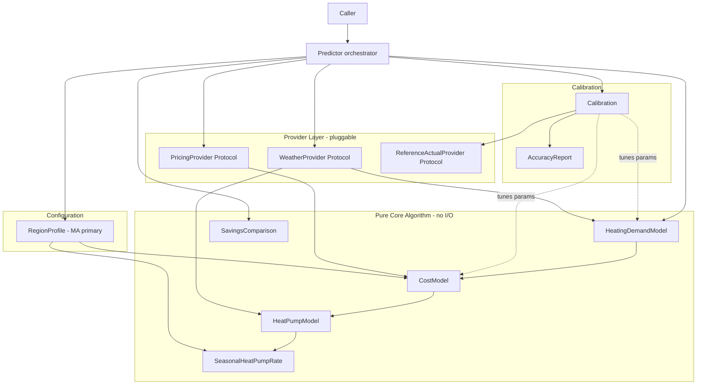
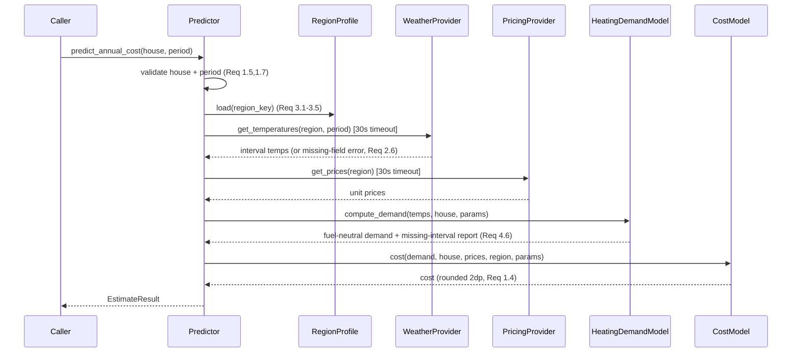

# Design Document

## Overview

The Energy Cost Predictor estimates residential heating energy costs and heat-pump savings for a house in a given region, with Massachusetts as the primary target. The design centers on a clean separation between a **pure, substitutable-data core algorithm** and **pluggable data providers**. Real data is not yet available, so every external fact (weather, prices, reference actuals) enters the algorithm through a provider interface. Placeholder providers supply realistic made-up values today; real providers drop in later with zero changes to the core algorithm (Requirements 2.4, 2.5).

The core pipeline is:

1. Resolve a `RegionProfile` from a region key (Req 3).
2. Pull interval outdoor temperatures from a `WeatherProvider` (Req 2, 4).
3. Compute fuel-neutral heating demand from the setpoint-minus-outdoor degree differences via `HeatingDemandModel` (Req 4).
4. Convert demand to a fuel cost via `CostModel`, either conventional fuel (Req 5) or heat-pump electricity using a temperature-varying COP curve with the MA seasonal rate (Req 6).
5. Compare conventional vs heat-pump annual costs via `SavingsComparison` (Req 7).
6. Calibrate a small set of model parameters against a `ReferenceHouse` until predicted cost is within the 1% `AccuracyTarget` (Req 8), and report accuracy (Req 9).

### Key Design Decisions

- **Providers are the only I/O seam.** The core models (`HeatingDemandModel`, `CostModel`, `HeatPumpModel`) are pure functions of their inputs and never touch a data source directly. This is what makes Req 2.5 ("zero changes to the core algorithm when swapping data sources") structurally guaranteed rather than merely hoped for.
- **Fuel-neutral energy unit.** Heating demand is expressed in a single neutral unit (kWh-thermal, i.e., delivered heat energy) before any fuel conversion (Req 4.5). This keeps the demand model independent of the fuel the house burns and lets conventional and heat-pump paths share one demand number.
- **Placeholder values live only in providers.** MA-ish constants (~$0.17/kWh electric, ~$6.00/gal oil, ~$2.50/therm gas, a COP curve that falls with temperature) exist exclusively inside placeholder provider implementations and the region profile data, never baked into the math in the core models.
- **Calibration tunes a single physically-meaningful scalar** (a building-loss / UA-style coefficient), with an optional secondary efficiency trim, so the search is stable and interpretable.
- **Python 3.14 + typing.Protocol** for the provider seams, with `numpy`/`pandas` for the interval arithmetic. `Protocol` (structural typing) means a real provider only needs matching method shapes, not an import of our base class — the loosest possible coupling for Req 2.5.

## Architecture

The system is layered: a thin orchestration layer (`Predictor`), a pure computation core, and a provider layer behind interfaces. Data flows one direction (providers → core → result); the core never calls back out to I/O.



### Layering and dependency rules

- **Predictor** depends on providers, the region profile, and the core models. It validates inputs (Req 1.5, 1.7, 3.4, 3.5), fetches provider data with a 30s timeout (Req 2.7, 8.7), and wires results together.
- **Core models** depend only on plain data classes and tunable `ModelParameters`. They have no knowledge of where data came from. This is the dependency boundary that satisfies Req 2.1–2.5.
- **Calibration** sits outside the core; it repeatedly runs the core with adjusted `ModelParameters` and never mutates core source code (Req 8).

### Request sequence (predict annual cost)



## Components and Interfaces

All provider interfaces are `typing.Protocol` classes. A provider is any object whose methods match the shape — no inheritance required — which is what lets a real data source replace a placeholder with no core changes (Req 2.4, 2.5).

### Provider interfaces

```python
from typing import Protocol, Sequence, Mapping, Optional
from datetime import date, datetime

class WeatherProvider(Protocol):
    def get_temperatures(
        self, region_key: str, start: date, end: date
    ) -> "WeatherSeries":
        """Return per-interval outdoor temperatures for [start, end].
        Missing intervals are represented by None in the series values,
        never silently dropped (supports Req 4.6, 2.6)."""
        ...

class PricingProvider(Protocol):
    def get_prices(self, region_key: str) -> "PriceTable":
        """Return unit prices keyed by fuel price key for the region
        (electricity $/kWh, gas $/therm, oil $/gal, propane $/gal)."""
        ...

class ReferenceActualProvider(Protocol):
    def get_reference_actual(self, house_id: str) -> "ReferenceActual":
        """Return the known actual annual heating cost for a reference
        house (Req 2.3, 8.6). Never hard-coded in the algorithm."""
        ...
```

Each provider call made by the `Predictor`/`Calibration` is wrapped so that:
- A missing/null/empty required field raises a `ProviderDataError` naming the provider and each missing field (Req 2.6, 5.6, 6.8).
- No response within 30s raises a `ProviderTimeoutError` naming the provider (Req 2.7, 8.7).

### Placeholder providers (ship now)

`PlaceholderWeatherProvider`, `PlaceholderPricingProvider`, `PlaceholderReferenceActualProvider` implement the Protocols with realistic made-up data. They are the ONLY place the following live:

- Electricity standard rate ≈ $0.17/kWh; MA seasonal heat-pump delivery discount (lower $/kWh Nov 1–Apr 30).
- Heating oil ≈ $6.00/gal; natural gas ≈ $2.50/therm; propane ≈ $3.00/gal.
- A synthetic MA winter temperature series (daily intervals, colder mid-winter).
- A COP curve table that falls as temperature drops (e.g., ~3.5 at 47°F down to ~1.8 at 5°F).

Swapping to real data = writing new classes with the same methods; the core never changes (Req 2.5).

### Core components

```python
class HeatingDemandModel(Protocol):
    def compute_demand(
        self, weather: "WeatherSeries", house: "HouseProfile",
        params: "ModelParameters"
    ) -> "DemandResult":
        """Fuel-neutral heating demand (kWh-thermal) from per-interval
        degree differences (Req 4.1-4.6)."""
        ...

class HeatPumpModel(Protocol):
    def electricity_kwh(
        self, weather: "WeatherSeries", demand: "DemandResult",
        cop_curve: "COPCurve"
    ) -> "HeatPumpUsage":
        """Per-interval kWh electricity = interval thermal demand / COP(temp)
        (Req 6.1-6.4)."""
        ...

class CostModel(Protocol):
    def conventional_cost(
        self, demand: "DemandResult", house: "HouseProfile",
        prices: "PriceTable", region: "RegionProfile",
        params: "ModelParameters"
    ) -> "CostResult": ...

    def heat_pump_cost(
        self, usage: "HeatPumpUsage", prices: "PriceTable",
        region: "RegionProfile"
    ) -> "CostResult": ...
```

- **SeasonalHeatPumpRate** is a function on the `RegionProfile`: given an interval date and the standard/seasonal electric rates, it returns the rate to apply (seasonal iff Nov 1 ≤ date ≤ Apr 30 inclusive) (Req 6.6, 6.7).
- **SavingsComparison** calls both cost paths and returns conventional, heat-pump, and savings = conventional − heat-pump (Req 7).
- **Calibration** wraps the pipeline, adjusting `ModelParameters` toward the `AccuracyTarget` (Req 8).
- **AccuracyReport** computes relative error and target met/not-met (Req 9).

### Predictor orchestrator

```python
class Predictor:
    def __init__(self, regions, weather_provider, pricing_provider,
                 demand_model, cost_model, heat_pump_model): ...

    def predict_annual_cost(self, house: HouseProfile,
                            period: Period) -> EstimateResult: ...

    def compare_savings(self, house: HouseProfile,
                        period: Period) -> SavingsResult: ...
```

## Data Models

All data models are `@dataclass(frozen=True)` where practical, keeping the core side-effect-free and easy to test.

### HouseProfile (input, Req 1, 3, 5)

```python
@dataclass(frozen=True)
class HouseProfile:
    house_id: str
    region_key: str                 # resolves to a RegionProfile (Req 3)
    heated_area_sqft: float
    ua_coefficient: float           # thermal loss coefficient; tunable seed
    setpoint_f: float               # thermostat setpoint (Req 4.2)
    conventional_fuel: str          # "natural_gas" | "heating_oil" | "propane" | "electric_resistance"
    system_efficiency: float        # 0 < eff <= 1 (Req 5.1, 5.5)
```

Required fields for a valid request: `region_key`, `heated_area_sqft`, `setpoint_f`, `conventional_fuel`, `system_efficiency`. A missing one triggers a named-field error (Req 1.5, 7.5).

### RegionProfile (config, Req 3, 6)

```python
@dataclass(frozen=True)
class FuelDef:
    fuel_type: str
    price_key: str                  # key into PriceTable (Req 3.6)
    energy_content: float           # per-unit energy (kWh-thermal per therm/gal/kWh)
    unit: str                       # "therm" | "gallon" | "kWh"

@dataclass(frozen=True)
class SeasonalRateRule:
    price_key: str                  # electricity
    seasonal_price_key: str         # discounted delivery key
    season_start: tuple[int, int]   # (11, 1) -> Nov 1
    season_end: tuple[int, int]     # (4, 30) -> Apr 30

@dataclass(frozen=True)
class RegionProfile:
    region_key: str
    fuels: Mapping[str, FuelDef]    # available fuels (Req 3.6)
    cop_curve: "COPCurve"
    seasonal_rate: Optional[SeasonalRateRule]   # set for Massachusetts (Req 3.2, 6.6)
    base_temperature_f: float       # HDD base, informational
```

### Weather and pricing data shapes

```python
@dataclass(frozen=True)
class WeatherInterval:
    interval_date: date
    outdoor_temp_f: Optional[float]   # None => missing (Req 4.6, 2.6)

@dataclass(frozen=True)
class WeatherSeries:
    region_key: str
    intervals: Sequence[WeatherInterval]

@dataclass(frozen=True)
class PriceTable:
    region_key: str
    # price_key -> $/unit; electricity standard + optional seasonal entry
    prices: Mapping[str, float]       # negative/missing => error (Req 5.6, 6.8)

@dataclass(frozen=True)
class COPCurve:
    # ascending temperature breakpoints and COP at each; monotonic non-decreasing
    points: Sequence[tuple[float, float]]   # [(temp_f, cop)], 1.0 <= cop <= 5.0 (Req 6.2, 6.3)
    def cop_at(self, temp_f: float) -> float: ...
```

### Tunable parameters and results

```python
@dataclass(frozen=True)
class ModelParameters:
    demand_scale: float = 1.0       # primary calibration knob (UA-style scalar)
    efficiency_trim: float = 1.0    # secondary trim, bounded near 1.0

@dataclass(frozen=True)
class DemandResult:
    total_demand_kwh_thermal: float       # fuel-neutral (Req 4.5)
    per_interval_kwh_thermal: Sequence[float]
    missing_intervals: Sequence[date]     # Req 4.6

@dataclass(frozen=True)
class HeatPumpUsage:
    total_kwh: float
    per_interval_kwh: Sequence[tuple[date, float]]

@dataclass(frozen=True)
class CostResult:
    cost_usd: float                 # non-negative, rounded 2dp (Req 1.4, 5.2)

@dataclass(frozen=True)
class SavingsResult:
    conventional_cost: float
    heat_pump_cost: float
    savings: float                  # conventional - heat_pump (Req 7.2, 7.3)

@dataclass(frozen=True)
class AccuracyReport:
    predicted: float
    actual: float
    relative_error_pct: float       # Req 9.1, 9.3
    target_met: bool                # Req 9.4, 9.5

@dataclass(frozen=True)
class CalibrationResult:
    params: ModelParameters
    best_relative_error_pct: float
    target_met: bool
    iterations: int
```

## Core Math

### 1. Heating demand (fuel-neutral), Req 4

For each interval `i` with outdoor temp `T_i` and setpoint `S`:

```
degree_diff_i = max(0, S - T_i)          # zero when T_i >= S (Req 4.3)
```

Per-interval thermal demand uses a degree-difference (HDD-style) model scaled by the building loss coefficient and the calibration scalar:

```
demand_i (kWh-thermal) = UA_effective * degree_diff_i * interval_hours
UA_effective           = ua_coefficient * heated_area_sqft * demand_scale
total_demand           = sum(demand_i over intervals that have data)   # Req 4.2, 4.5
```

Intervals whose `outdoor_temp_f` is `None` are excluded and listed in `missing_intervals` (Req 4.6). Because each term is `max(0, S - T_i) >= 0` and the coefficients are positive, lowering any interval's temperature strictly increases that interval's term while it is below setpoint, so a uniformly colder period yields strictly greater total demand (Req 4.4).

### 2. Conventional fuel quantity and cost, Req 5

```
delivered_heat = total_demand_kwh_thermal
fuel_energy_input = delivered_heat / (system_efficiency * efficiency_trim)   # 0 < eff <= 1 (Req 5.1, 5.5)
fuel_quantity = fuel_energy_input / fuel.energy_content   # therms / gallons / kWh (Req 5.3)
conventional_cost = round(fuel_quantity * price[fuel.price_key], 2)          # Req 5.2
```

Guards: unsupported fuel for the region → named error (Req 5.4); efficiency out of (0,1] → error (Req 5.5); missing/negative price → error (Req 5.6).

### 3. Heat-pump electricity from COP curve, Req 6

For each interval, convert the interval's thermal demand to electricity using the COP for that interval's temperature:

```
demand_i_kwh_thermal  (from step 1)
cop_i = cop_curve.cop_at(T_i)            # 1.0 <= cop_i <= 5.0, monotonic with temp (Req 6.2, 6.3)
elec_i = demand_i_kwh_thermal / cop_i    # skip division entirely when demand_i == 0 (Req 6.4)
total_kwh = sum(elec_i)
```

Because `elec_i` decreases as `cop_i` increases for fixed thermal demand, total kWh is monotonic (non-increasing) in COP (Req 6.3).

### 4. Seasonal rate application, Req 6.6–6.7

For each interval date `d`:

```
in_season = (Nov 1) <= d <= (Apr 30)     # inclusive, wraps year boundary (Req 6.6)
rate_d = seasonal_price if (region.seasonal_rate and in_season) else standard_price   # Req 6.7
heat_pump_cost += elec_i * rate_d
heat_pump_cost = round(heat_pump_cost, 2)
```

Missing electricity price halts computation and returns an error, leaving prior values intact (Req 6.8).

### 5. Savings, Req 7

```
savings = round(conventional_cost - heat_pump_cost, 2)   # may be negative (Req 7.2, 7.3)
```

### 6. Relative error and accuracy, Req 9

```
relative_error = abs(predicted - actual) / actual        # actual > 0 (Req 9.1, 9.2)
relative_error_pct = round(relative_error * 100, 2)       # Req 9.3
target_met = relative_error_pct <= 1.00                   # Req 9.4, 9.5
```

## Calibration Approach (Req 8)

Calibration tunes `ModelParameters.demand_scale` (the primary UA-style scalar) to drive the Reference_House predicted annual cost toward its known actual, within 1% relative error, in at most 100 iterations.

**Why `demand_scale`:** predicted cost is monotonic and roughly linear in `demand_scale` (more loss → more demand → more fuel → more cost), so a bounded one-dimensional search converges quickly and stays physically interpretable. `efficiency_trim` is available as a secondary bounded knob if a single scalar proves insufficient, but the default strategy tunes the single dominant parameter.

**Procedure:**
1. Obtain actual annual cost via `ReferenceActualProvider` (Req 8.6) under a 30s timeout (Req 8.7). Reject actual ≤ 0 (Req 8.2).
2. Evaluate predicted cost at the current `demand_scale`; compute relative error (Req 9.1).
3. Adjust `demand_scale` to reduce relative error each iteration — a bounded bisection/secant step using the monotonic relationship (predicted too low → increase scale; too high → decrease). Each iteration must not increase the tracked best error.
4. Stop when relative error ≤ 1% (success) or after 100 iterations (Req 8.1).
5. On success, retain calibrated params and use them for all same-region predictions afterward (Req 8.4); predicted reference cost is then within 1% (Req 8.3).
6. On failure to converge, return the best achieved error and retain the params that produced it (Req 8.5).

Because the objective is monotonic in `demand_scale`, bisection guarantees the tracked best error is non-increasing across iterations and that, if a scale achieving ≤1% exists in the search bounds, it is found within the iteration budget.


## Correctness Properties

*A property is a characteristic or behavior that should hold true across all valid executions of a system — essentially, a formal statement about what the system should do. Properties serve as the bridge between human-readable specifications and machine-verifiable correctness guarantees.*

The core algorithm is a set of pure functions over generated inputs (temperatures, setpoints, prices, COP values, dates, cost pairs), which makes property-based testing the right tool for the computation core. The properties below were derived from the acceptance-criteria prework and consolidated to remove redundancy.

### Property 1: Zero demand at or above setpoint

*For any* weather series and house, every interval whose outdoor temperature is greater than or equal to the thermostat setpoint contributes exactly zero to heating demand, and a period whose every interval is at or above setpoint produces a total heating demand of exactly zero.

**Validates: Requirements 4.3**

### Property 2: Colder periods yield strictly greater demand

*For any* weather series in which at least one interval is below the setpoint, a variant period whose every interval temperature is strictly lower (and still at or below setpoint where it was below) produces a strictly greater total heating demand than the original.

**Validates: Requirements 4.4**

### Property 3: Conventional cost conversion is correct, non-negative, and rounded

*For any* fuel-neutral demand, system efficiency in (0, 1], positive fuel energy content, and non-negative fuel unit price, the conventional cost equals `round(demand / efficiency / energy_content * price, 2)`, is non-negative, and equals its own value rounded to two decimal places.

**Validates: Requirements 1.2, 1.4, 5.1, 5.2**

### Property 4: Missing intervals are excluded and reported

*For any* weather series containing missing (None) outdoor temperatures, the heating demand total equals the sum over only the present intervals, and the reported missing-interval list equals exactly the set of intervals with missing data.

**Validates: Requirements 4.6**

### Property 5: Heat-pump electricity is kWh = demand / COP and monotonic in COP

*For any* fixed non-zero interval thermal demand, heat-pump electricity consumption equals that demand divided by the interval COP, and for any two COP values the higher COP yields less than or equal electricity consumption; the COP curve assigns a COP to a lower temperature that is less than or equal to the COP for a higher temperature.

**Validates: Requirements 6.1, 6.3**

### Property 6: Zero demand produces zero heat-pump electricity

*For any* interval whose thermal demand is zero, the heat-pump electricity consumption is exactly zero kilowatt-hours and no division by COP is performed.

**Validates: Requirements 6.4**

### Property 7: Seasonal rate applies exactly within the Nov 1–Apr 30 window

*For any* interval date and a region defining a Seasonal_Heat_Pump_Rate, the applied electricity rate is the seasonal rate if and only if the date falls between November 1 and April 30 inclusive, and the standard rate otherwise.

**Validates: Requirements 6.6, 6.7**

### Property 8: Savings equal conventional minus heat-pump cost

*For any* conventional cost and heat-pump cost produced by the pipeline, the reported savings equal `round(conventional_cost - heat_pump_cost, 2)`, including negative values when the heat-pump cost is greater.

**Validates: Requirements 7.2, 7.3**

### Property 9: Relative error and accuracy target are computed correctly

*For any* predicted cost and actual annual cost greater than zero, the reported relative error percentage equals `round(abs(predicted - actual) / actual * 100, 2)`, is non-negative, and the Accuracy_Target is reported as met if and only if that percentage is less than or equal to 1.00.

**Validates: Requirements 9.1, 9.3, 9.4, 9.5**

### Property 10: Calibrated reference prediction lands within the accuracy target

*For any* reference actual annual cost greater than zero that is reachable within the calibration search bounds, calibration terminates with a predicted annual cost whose relative error against the actual is less than or equal to the 1 percent Accuracy_Target.

**Validates: Requirements 8.1, 8.3**

## Error Handling

Errors are modeled as explicit, typed exceptions raised by the orchestration and provider-adapter layers. The pure core raises `ValueError`-style domain errors; it never returns partial or default-valued results (Req 2.6).

| Condition | Error type | Behavior | Requirement |
|---|---|---|---|
| Missing required HouseProfile field | `MissingFieldError` | Names the field; no estimate returned | 1.5, 7.5 |
| Period end before start | `InvalidPeriodError` | Names the problem; no estimate | 1.7 |
| Period not 12 consecutive months (savings) | `InvalidPeriodError` | No cost/savings returned | 7.6 |
| Dependency (demand model / pricing) unavailable | `DependencyUnavailableError` | Names the dependency; no estimate | 1.6 |
| Provider required field absent/null/empty | `ProviderDataError` | Names provider + each missing field; halts, no partial estimate | 2.6, 5.6, 6.8 |
| Provider no response within 30s | `ProviderTimeoutError` | Names provider; halts | 2.7, 8.7 |
| Unknown region key | `UnknownRegionError` | Names key; prior loaded profile unchanged | 3.4 |
| Empty/null region key | `MissingRegionKeyError` | Indicates region key missing | 3.5 |
| Unsupported fuel for region | `UnsupportedFuelError` | Names fuel type; no cost | 5.4 |
| Efficiency ≤ 0 or > 1 | `EfficiencyOutOfRangeError` | No cost | 5.5 |
| Missing/negative fuel or electricity price | `PriceUnavailableError` | Prior values retained unchanged; no cost | 5.6, 6.8 |
| Reference actual ≤ 0 | `InvalidActualCostError` | No parameter adjustment | 8.2 |
| Reference actual == 0 for accuracy | `AccuracyUncomputableError` | No Accuracy_Target result | 9.2 |

Principles:
- **Fail fast, name the cause.** Every error identifies the offending field, provider, region, fuel, or dependency so callers can act (Req 1.5, 2.6, 3.4, 5.4).
- **No partial outputs.** A failed estimate returns no cost rather than a default (Req 1.5, 2.6, 6.8).
- **State preservation.** Price/calibration failures leave previously computed values and parameters unchanged (Req 6.8, 8.5, 3.4).
- **Timeouts are enforced at the provider-adapter boundary** (concurrent-futures style wait with a 30s deadline), keeping the core unaware of I/O (Req 2.7, 8.7).

## Testing Strategy

The feature's computation core is made of pure functions with large input spaces (temperatures, setpoints, prices, COP curves, dates, cost pairs) and clear universal properties (monotonicity, round-trips of arithmetic, boundary windows). That makes **property-based testing appropriate and primary** for the core, complemented by example and edge-case unit tests for validation and error paths, and a small set of integration tests for provider substitution.

### Property-based tests (primary for the core)

- **Library:** `hypothesis` for Python. We do not implement property testing from scratch.
- **Iterations:** each property test runs a minimum of 100 generated examples (`@settings(max_examples=100)` or higher).
- **Tagging:** each property test carries a comment referencing its design property, in the format:
  `# Feature: energy-cost-predictor, Property {number}: {property_text}`
- **Coverage:** one property-based test per correctness property (Properties 1–10). Generators produce valid `HouseProfile`s, `WeatherSeries` (including missing intervals), price tables, COP curves, interval dates across the full year (to exercise the seasonal window boundaries Nov 1 / Apr 30), and positive reference actuals within the calibration search bounds.
- **Edge cases handled by generators:** temperatures at and above setpoint (Property 1), uniformly colder variants (Property 2), None intervals (Property 4), zero demand (Property 6), dates exactly on Nov 1 and Apr 30 (Property 7), and heat-pump cost exceeding conventional (Property 8).

### Unit tests (examples and edge cases)

- Validation and error paths from the Error Handling table: missing fields (1.5), reversed/non-annual periods (1.7, 7.6), unknown/empty region keys (3.4, 3.5), unsupported fuel (5.4), out-of-range efficiency (5.5), missing/negative prices (5.6, 6.8), reference actual ≤ 0 and == 0 (8.2, 9.2), provider missing field and timeout (2.6, 2.7).
- A representative conventional-cost example per supported fuel (natural gas/therm, oil/gal, propane/gal, electric resistance/kWh) to pin units (Req 5.3).
- Fuel-neutrality check: demand is independent of the house fuel type (Req 4.5).

### Integration tests (provider substitution)

- Run an identical prediction scenario through two different providers that expose the same Protocol (a placeholder and a second stub) and assert identical results **without modifying any core module source** — the executable demonstration of Req 2.4 and 2.5.
- End-to-end annual prediction and savings comparison using placeholder providers, asserting the 5-second predict budget (Req 1.1) and value ranges (Req 7.4).

### Calibration test

- A dedicated property test (Property 10) generates reachable positive actual costs, runs calibration against the placeholder reference provider, and asserts convergence to ≤ 1% relative error within the 100-iteration budget, plus a non-convergence example (target outside reachable bounds) asserting best-error retention (Req 8.5).
